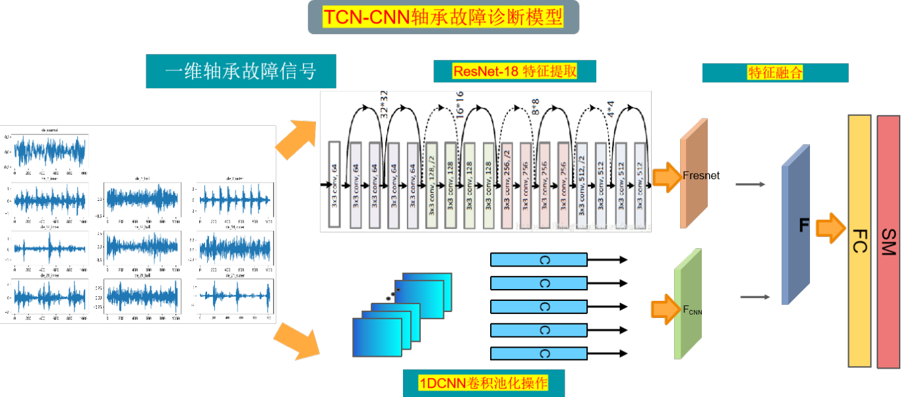
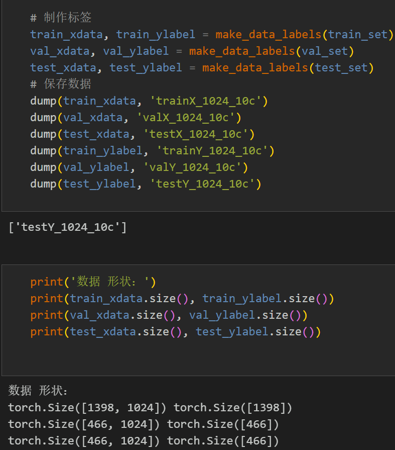
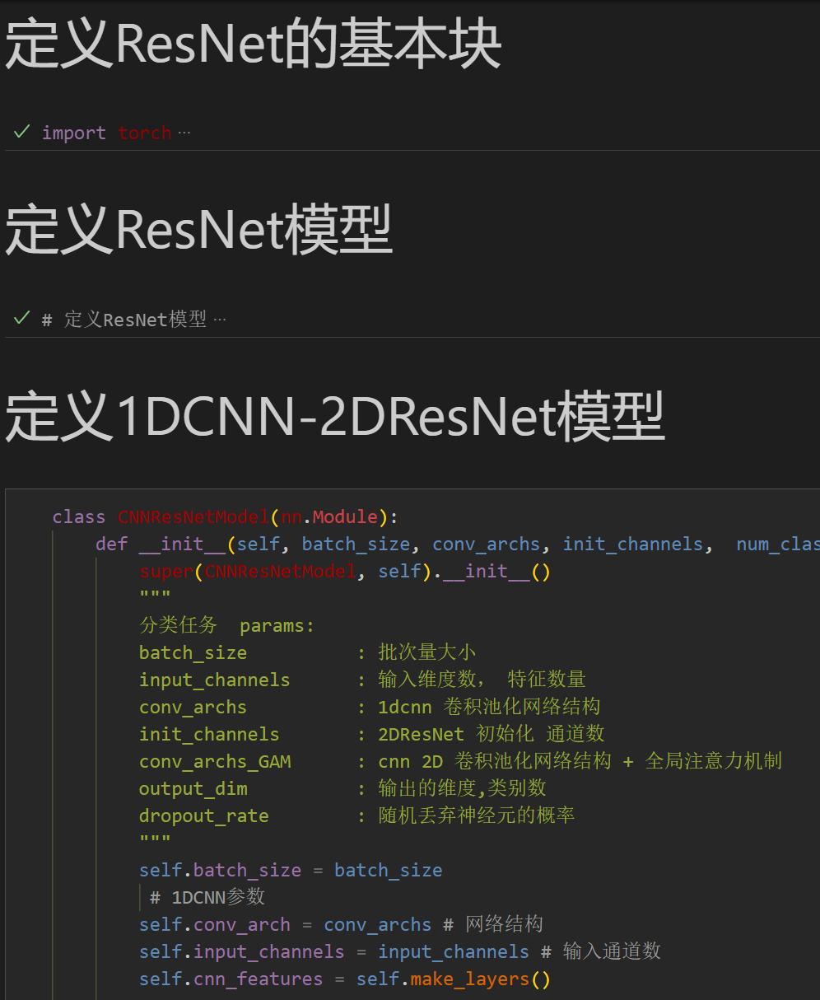
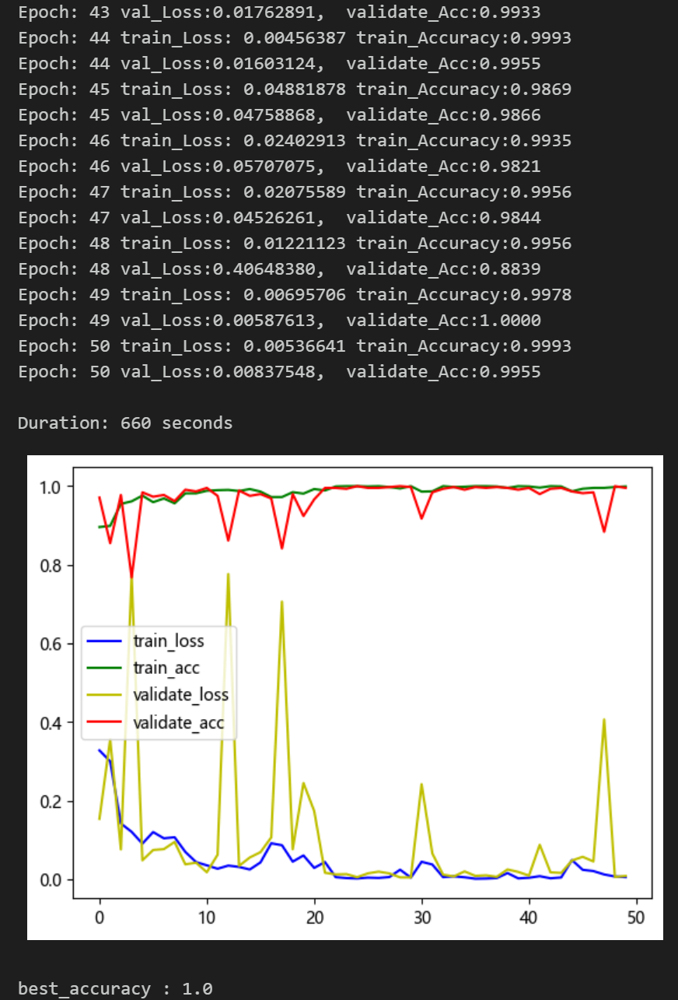
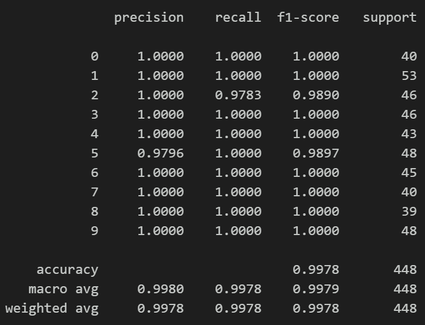
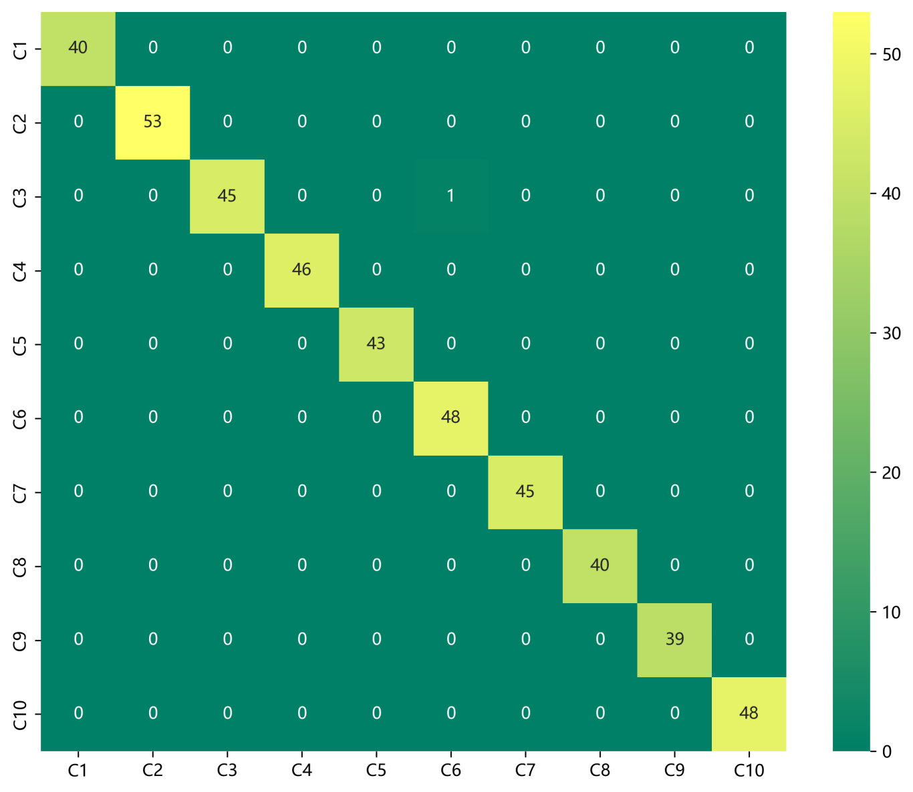
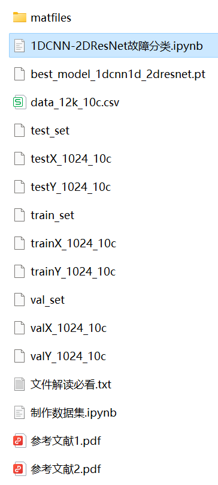

# 1DCNN-2DResNet Parallel Fault Diagnosis Model

● Dataset: The model has achieved a classification accuracy of 99% on both the CWRU West Reserve University bearing dataset and the Harbin Institute of Technology Aerospace Engine Bearing Dataset after testing.
● Environment Framework: Python 3.9, PyTorch 1.8 and above can be run.
● Accuracy: 99% on the test set.
● Usage Object: Paper requirements, graduation design requirements.
● Code Guarantee: The code comments are detailed and ready to run.
Innovation Point:
Branch 1: The time-series signal of bearing failure is used as the input to the CNN module. Through a series of 1D convolutional layers and pooling layers, it realizes the extraction of time domain and local features from the signal data.
Part Two: The bearing fault signal is first stacked into a 2D matrix, and then the global feature extraction of the data is performed using the 2D ResNet convolutional layer and residual blocks.
Parallel fusion: The outputs of the 1D CNN module and the 2D ResNet module are fused in parallel to obtain feature representations that integrate both temporal and frequency information. These feature representations are then classified through fully connected layers, ultimately leading to fault diagnosis results. Through the parallel processing of the 1D CNN and the 2D ResNet, this model can effectively utilize both time-domain and frequency-domain information, thereby enhancing the accuracy and robustness of fault diagnosis. It also fully exploits the correlation between data, improving the performance of fault diagnosis.
Preface
This paper is based on the bearing data from Case Western Reserve University (CWRU), which first undergoes data preprocessing to create and load the dataset, and finally implements a 1DCNN-2DResNet parallel model for classifying faulty data through Pytorch. For a detailed introduction to the bearing data from CWRU, please refer to the following article:
Python-Case Western Reserve University (CWRU) Bearing Data Interpretation and Classification Process
\t  
1. Data preprocessing for bearing faults
1.1 Import data
Refer to the previous article for preprocessing of fault classification 10, and the Case Western Reserve University bearing data set: Classification 10 dataset.
1. Train set, val set, test set are divided into 7:2:1 according to the training set, validation set and test set. Finally, the data is saved.
The above figure is the form of data reading and preprocessing idea.
1.2 Data preprocessing, making a dataset.
2. Bearing Fault Diagnosis Based on Pytorch's 1DCNN-2DResNet
2.1 Define the 1DCNN-2DResNet classification network model.
2.2 Set parameters, train the model.
50 epochs, accuracy 100%, with the parallel network of 1DCNN-2DResNet for fault diagnosis, the effect is significant. The model can fully extract the global space and local features of bearing fault signals, converge quickly, have excellent performance, high accuracy, and obvious effect!
2.3 Model evaluation
Accuracy, Precision, Recall, F1 Score
Fault very class confusion matrix:
Previously interesting content:
Python-Case Western Reserve University (CWRU) Bearing Data Interpretation and Classification Process
Python Bearing Fault Diagnosis (I) Short Time Fourier Transform STFT
Python Bearing Fault Diagnosis (II) Continuous Wavelet Transform CWT
Python Bearing Fault Diagnosis (III) Empirical Mode Decomposition EMD
Pytorch-LSTM Bearing Fault One-Dimensional Signal Classification (I)
Pytorch-CNN Bearing Fault One-Dimensional Signal Classification (II)
Pytorch-Transformer Bearing Fault One-Dimensional Signal Classification (III)
Python Bearing Fault Diagnosis (IV) Based on EMD-CNN Fault Classification
Python Bearing Fault Diagnosis (V) Based on EMD-LSTM Fault Classification
Python Bearing Fault Diagnosis (VI) Based on EMD-Transformer Fault Classification
Python Bearing Fault Diagnosis (7) Fault Classification Based on EMD-CNN-LSTM
Python Bearing Fault Diagnosis (8) Fault Classification Based on EMD-CNN-GRU Parallel Model
Bearing Fault Identification Model Based on FFT + CNN - BiGRU-Attention for Time and Frequency Feature Attention Fusion
Bearing Fault Identification Model Based on FFT + CNN - Transformer for Time and Frequency Feature Fusion
Python Bearing Fault Diagnosis (9) Fault Classification Based on VMD+CNN-BiLSTM
Python Bearing Fault Diagnosis (10) Fault Classification Based on VMD+CNN-Transformer
Python Bearing Fault Diagnosis (11) Fault Classification Based on VMD+CNN-BiGRU-Attention
Cross Attention Fusion of Time and Frequency Features with VMD + CNN - BiLSTM-CrossAttention Bearing Fault Identification Model
Cross Attention Fusion of Time and Frequency Features with VMD + CNN-Transformer-CrossAttention Bearing Fault Identification Model
Introduction to Python Bearing Fault Diagnosis
Python Bearing Fault Diagnosis (13) Super-strong Machine Learning Identification Model Based on Fault Signal Feature Extraction
Python Bearing Fault Diagnosis (14) Highly Innovative Fault Identification Model
Python Bearing Fault Diagnosis (15) One-Dimensional Fault Signal Identification Model Based on CNN-Transformer
Python Bearing Fault Diagnosis (16) Highly Innovative Fault Identification Model (II)
SCI 1st Region Highly Innovative Bearing Fault Diagnosis Model!
Python Bearing Fault Diagnosis (18) Innovative Diagnosis Model Based on CNN-TCN-Attention
Based on GADF+Swin-CNN-GAM, a High-Innovation Bearing Fault Diagnosis Model
Attention Magic Modification | Super Bearing Fault Diagnosis Model!
Bearing Fault—Cross Attention Innovation Model Full Set
Python Bearing Fault Diagnosis (19) Based on Transformer-BiLSTM Innovative Diagnosis Model
End

## Images

<!-- PAYMENT_BLOCK -->

## Get this dataset

- Payment link (Stripe): [Buy now](https://buy.stripe.com/3cs8yP7sY87d0vu9AB)
- Payment QR code: 

<!-- /PAYMENT_BLOCK -->
